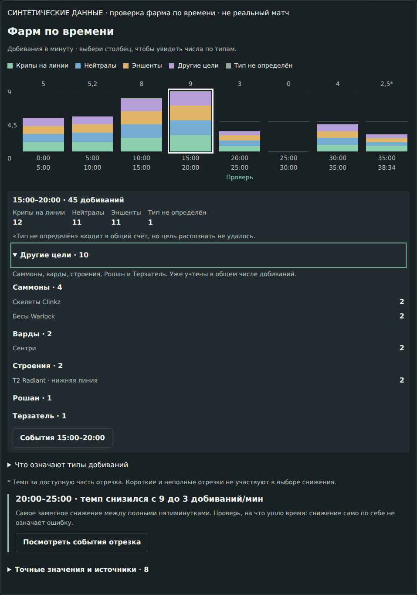
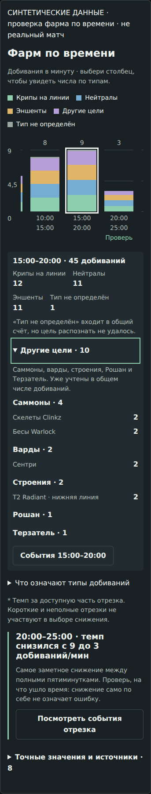

# Расшифровка целей фарма

Патч от `main` после PR #79. Отдельная категория «Другие цели» показывает только
распознанные цели, с раскрытием групп, названий и количества. Неизвестное не переименовано
в «другие». Общий счёт, темп, выбор отрезка, челлендж и проверка роли не меняются.

## Подтверждённые данные

Проверен исходный сохранённый ответ владельца от 2026-11-03, SHA256
`2e8b153a247b862d8f713c41e069891fe0c25627b4be06226c0eed2ba79501b0`.
Идентичности жертв сверены с уже имеющимся результатом разбора настоящих реплеев:
[visual-review-data.json](../../research/stratz-coordinates/visual-review-data.json).
Связь — последовательные увеличения счётчика добиваний героя/WK-скелетов и время
в пределах двух секунд; координаты для сопоставления не использованы.
Скрипт проверяет хэш исходного ответа, каждое соответствие ID → жертва и наличие
реального наблюдения для каждой из 18 записей словаря.

| Матч | Версия STRATZ | Всего | На линии | Нейтралы | Эншенты | Другие | Не определено |
| --- | ---: | ---: | ---: | ---: | ---: | ---: | ---: |
| 9019592113 | 190 | 302 | 117 | 179 | 4 | 2 | 0 |
| 9003795847 | 190 | 281 | 163 | 93 | 9 | 16 | 0 |

До патча было 44 + 33 нераспознанных добивания: у всех три признака типа были `false`.
Из них 56 — обычные нейтралы-лягушки, 3 — древние нейтралы; 18 других целей:
8 саммонов (Warlock/Clinkz), 7 строений, 1 сентри, 1 Рошан и 1 Терзатель.
У 12 из этих 77 добиваний исполнителем был скелет WK. Категория относится к жертве;
эти события не теряются и не становятся «саммонами» из-за исполнителя.

[real-capture-verification.json](real-capture-verification.json) содержит итог по каждому
отрезку и целям. Счёт всех 583 событий, значения/темп всех пятиминуток и индексы
выбранного снижения совпали с вариантом без новой классификации.

Классы нейтралов и признак древнего крипа дополнительно сверены с
[файлом Valve `npc_units.txt`, фиксированный снимок](https://github.com/SteamTracking/GameTracking-Dota2/blob/b671cd08d5da5820ff0ad64fd26fcf32f615d197/game/dota/pak01_dir/scripts/npc/npc_units.txt).
Минимальные извлечённые поля и хэш всего файла:
[npc-definition-excerpts.json](npc-definition-excerpts.json).
Это подтверждение типа названного юнита, **не** источник числовых ID STRATZ и не
доказательство полного исторического словаря. Например, `IsAncient` у Терзателя
не делает его обычным эншентом фарма: он показан как отдельный объект.

## Границы применения

- Словарь действует только при `gameVersionId === 190`, для 18 проверенных ID.
  Матч-ID в рабочей логике не используется. Другие версии и неизвестные ID
  продолжают использовать явные признаки STRATZ; если их нет — тип не определён.
- Новые соответствия нельзя добавлять по диапазону ID, имени атакующего или одной
  похожей строке. Нужны проверяемая идентичность жертвы и версия источника.
- Дополнение по ID применяется, когда все три признака явно `false`.
  Пропущенные, пересекающиеся или противоречащие словарю признаки остаются неизвестными.
- Новых запросов к провайдерам нет: существующий запрос получает дополнительно
  `match.gameVersionId` и `csEvents.npcId`. Эти поля присутствуют в сохранённой схеме
  и реальных ответах. Передача фарма другого игрока через alias по-прежнему запрещена.
- Полная классификация всех юнитов и всех патчей не заявляется. В неполном потоке
  событий состав показывается только в деталях, отдельно от общего темпа OpenDota.
- Свежий запрос изменённой продуктовой выборки к STRATZ не проверен: в окружении
  нет токена. Анонимный запрос схемы получил HTTP 403. Токен в чат не запрашивался.
  Новый декод реплеев, визуальный просмотр в клиенте и проверка координат не проводились.
  `productReady=false` координатного слоя сохранён.

## Воспроизведение

```text
node scripts/verify-farm-capture.mjs <путь-к-исходному-json> <путь-к-новому-отчёту-json>
```

Скрипт работает офлайн, не читает токены, не публикует исходный ответ и отвергает
подменённый файл по хэшу. Нужен оригинальный сохранённый ответ; он не включён в репозиторий.

## Проверки

- `npm run test:unit` — 227/227.
- `npm run test:combat` — 34/34.
- `npm run test:stratz-research` — 34/34 (синтетические тесты исследовательских скриптов).
- `npm run test:benchmarks` — 9/9.
- `npm run check:design` — guard и 6/6 тестов.
- `npm run lint`, `npm run typecheck`, `npm run build` — успешно.
- `npm run check:coordinate-review` — закрытая исследовательская страница возвращает
  404 в production, данные не попадают в HTML или RSC.
- `verify-farm-capture.mjs` — обе реальные сохранённые выборки прошли сверку.
- `verify-post-match-v2.mjs` — 16 групп браузерных проверок, без ошибок консоли.
  Новый блок проверен на 320/390/768/1440 px; общий отчёт также на 1920/2560 px.
  Проверены группы/названия/количества, неизвестный тип, скрытие нулевых категорий,
  частичный поток, клавиатурное раскрытие и сохранение фокуса при выходе с графика.
  Остались зелёными loading/error/empty/partial, проверка роли, повторы, челлендж и его 3/3.

Браузерные ответы **синтетические**, собраны настоящими нормализаторами и правилами;
это не приёмка живого STRATZ. На самих изображениях есть соответствующая пометка.
[Отчёт браузерных проверок](browser-verification.json).

| Desktop, viewport 1440 px | Mobile, viewport 390 px |
| --- | --- |
|  |  |

## Self-review

Проверен совокупный diff от `50e9ac3`: запрос → нормализатор → интервалы → проверка
ответа → график и раскрытие, включая новые файлы словаря и доказательств.
Классификация жертвы отделена от атакующего, дубликаты одного времени сохранены,
границы отрезков не дают двойного счёта, частичная выборка не подменяет общий темп.
Проверено ограничение словаря версией и сохранение неизвестных/противоречивых данных.
В ходе проверки исправлена потеря клавиатурного фокуса при переходе из предпросмотра
столбца в раскрытие. Визуально проверены финальные скриншоты desktop/mobile.
Свежий end-to-end запрос к STRATZ остаётся непроверенным по причине выше.
