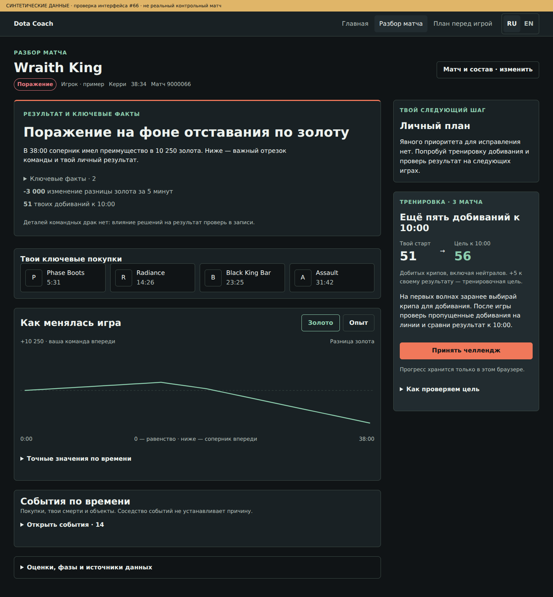
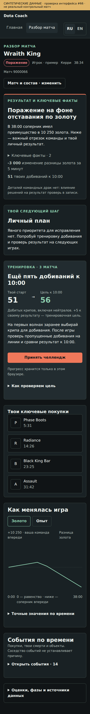

# Post-match v2 — экраны для визуальной оценки

Все снимки — **синтетический сценарий**, созданный реальными adapter/rules из `postMatchV2.fixture.ts`. Это не разбор реального матча владельца и не live-приёмка #34. Вверху каждого изображения есть соответствующая отметка. Сценарий демонстрирует поражение команды и личный старт без автоматического обвинения за одну смерть.

| Экран | Снимки |
| --- | --- |
| Desktop | [1440](ready-1440.png), [1920](ready-1920.png), [2560](ready-2560.png) |
| Mobile / tablet | [320](ready-320.png), [390](ready-390.png), [768](ready-768.png) |
| Раскрытые факты на mobile | [390](ready-expanded-390.png) |
| Один основной приоритет | [Desktop](one-priority.png), [mobile](one-priority-390.png) |
| Принятый челлендж и проверка трёх игр | [Прогресс](challenge-progress.png) |
| Неполные / отсутствующие данные | [Partial](partial-data.png), [empty](empty-data.png) |
| Остальные состояния | [Начало](initial.png), [загрузка](loading.png), [ошибка](error.png), [неподдерживаемая роль](unsupported-role.png) |

На всех шести ширинах проверено отсутствие горизонтального скролла страницы. Browser-сценарии также проверяют keyboard/focus, переход к evidence, сохранение и дедупликацию челленджа, отсутствие ложного зачёта при пропусках, изоляцию игроков, устаревшие ответы и заблокированный localStorage. [Машинный протокол](verification.json).

Иконки предметов в этой среде показаны буквенным fallback: внешний CDN был недоступен браузеру. Снимки не подтверждают доступность CDN в production.

## Desktop · 1440

## Mobile · 390

