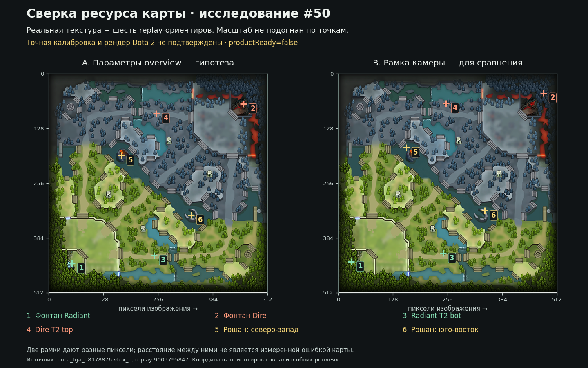

# #50 — referenced texture получена; сверка ориентиров

**Оба запрошенных архива получены. Цепочка `overview → material → texture`
проверена на реальных bytes; дополнительные выгрузки map assets сейчас не нужны.**
Это продолжение [первой проверки архива](2026-11-04-assets.md) в PR #73.
Подложка декодирована и сопоставлена с шестью replay-ориентирами. Точная калибровка,
активный рендер клиента и семантика CS XY остаются неподтверждёнными.
`productReady=false`, `structural_only`, нормализатор, adapter и порог 5s сохранены.

## Подтверждено реальными файлами

| Объект | Байты | SHA-256 |
|---|---:|---|
| `dota50-map-reference.zip` | 628049 | `c696b7b2bf6fa1c318cf38ac4a9c25ed7c66c08777738e03b22d5e8cf4c28c4b` |
| `materials/overviews/dota_tga_d8178876.vtex_c` | 1050660 | `1ea55acc8b50b26a9a6e456b8746101c994f4c6b664b40c2385f4fc51cc58f2c` |
| `manifest.json` | 178 | `b4f3b7210ce7fd72808ac7f37726c5ed79b922bd863b9553180d5bbd26fad9d2` |

- Проверены ZIP, оба ожидаемых файла, SHA-256/размер texture по manifest.
- CRC32 texture **`d9e2fc78`** и размер совпали с обоими историческими VPK
  каталогами: [6933](https://github.com/SteamTracking/GameTracking-Dota2/blob/f61235b7975ff3be0131e57076191b61410c15ec/game/dota/pak01_dir.txt)
  и [6941](https://github.com/SteamTracking/GameTracking-Dota2/blob/e84714d6ff871cfae0b59f3f9038860f052fa247/game/dota/pak01_dir.txt).
  Хеши самих каталогов повторно сверены. Исторических оригинальных bytes для
  сравнения SHA-256 по-прежнему нет; совпадение метаданных не подменяет эту проверку.
- Путь точно соответствует `g_tColor` и RERL ранее полученного `dota.vmat_c`.
  CLI 20.1 декодировал **512×512, RGBA8888, один mip**; внешних resource references
  у texture нет. Все alpha равны 255. Размеры совпали с representative dimensions
  материала. Распечатанное CLI `File Size: 2084` — размер resource header/blocks;
  полный файл с 1048576 байт pixel payload имеет 1050660 байт, он не обрезан.
- [PNG без наложений](map-reference/dota_tga_d8178876.png), SHA-256
  `54555b9d9a9533ab3d39b0719b941ff9ce4b37b9b2777718ef9d87fbc7a12914`.

Полный [машинный протокол](observations-map-reference-2026-11-04.json) хранит
источники, хеши, формулы и численные проекции. Это реальные входные данные,
а не синтетическая проверка координат. Исходные ZIP/VTEX и бинарники CLI в PR не добавлены.

## Что показывает наложение и чего оно не доказывает



Все шесть world-позиций совпадают в двух реплеях. Для рисунка взят набор из
9003795847: второе появление Рошана здесь происходит в 27:40.100, до конца матча.
В 9019592113 оно зарегистрировано уже после конца игры; это не игровой эпизод
данного матча. Остальные выбранные ориентиры доступны в предматчевом состоянии.

**A — гипотеза overview.** Из реального `dota.txt`: `pos_x=-9472`, `pos_y=9472`,
`scale=18.5`. [Source SDK WorldToMap](https://github.com/ValveSoftware/source-sdk-2013/blob/019e91ccd650a34745934c65cdbbe89ffcc44ede/src/game/client/game_controls/MapOverview.cpp)
и [логический размер 1024](https://github.com/ValveSoftware/source-sdk-2013/blob/019e91ccd650a34745934c65cdbbe89ffcc44ede/src/game/client/game_controls/mapoverview.h)
дают основание проверить следующий кандидат для физического PNG 512×512:

```text
pixelX = (worldX + 9472) / 37
pixelY = (9472 - worldY) / 37
```

Рисунок использует условную область `[-9472,9472]²` и непрерывные координаты
пикселей 0…512. Конвенция центров/краёв пикселя и деление на 1024 именно в Dota 2
не проверены; у Source SDK при отрисовке углов используется также `SIZE-1`.
Это **аналогия с исходником Source SDK, не подтверждённый алгоритм Dota 2**.
Ни масштаб, ни сдвиг не подбирались по точкам.

**B — сравнение с прежней рамкой камеры.** `X=[-8448,8448]`, `Y=[-9472,8448]`.
Показано растяжение этой рамки на тот же bitmap, как при ручной загрузке изображения
в служебную схему. Камерная рамка не равна параметрам overview; изображение в
`/debug/coordinates` по-прежнему нельзя считать откалиброванным.

| № | Ориентир | Replay world XY | A: pixel XY | B: pixel XY |
|---|---|---|---|---|
| 1 | Фонтан Radiant | −7456; −6938 | 54.49; 443.51 | 30.06; 439.60 |
| 2 | Фонтан Dire | 7408; 6848 | 456.22; 70.92 | 480.48; 45.71 |
| 3 | Radiant T2 bot | −360; −6256 | 246.27; 425.08 | 245.09; 420.11 |
| 4 | Dire T2 top | −128; 6016 | 252.54; 93.41 | 252.12; 69.49 |
| 5 | Рошан, северо-запад | −3194.28125; 2394.625 | 169.67; 191.28 | 159.20; 172.95 |
| 6 | Рошан, юго-восток | 2859.75; −2764.78125 | 333.29; 330.72 | 342.66; 320.37 |

Визуально A помещает фонтаны в соответствующие участки баз, а точки Рошана — в
изображённые области обеих ям. Это поддерживает ориентацию «X вправо / world Y
вверх» и кандидат масштаба. T2 лежат на соответствующих линиях, но независимые
точные центры башен в схематичной texture не размечены. **Пиксельная погрешность
не измерена**: нет ground truth центров объектов в кадре клиента. Разность A/B —
разность двух способов проекции, не измеренная ошибка относительно игры.

Не доказано, что клиент именно этих реплеев выбирает default material, а не
`simple_material` или иной режим. Из правильного файла не следует правильность
времени CS, принадлежность XY атакующему/жертве или точность nearest death position.

## Воспроизведение

Использован тот же проверенный [CLI 20.1](2026-11-04-assets.md#декодирование-и-первоисточники).
После извлечения второго ZIP (Windows-разделители путей заменить на `/`):

```bash
./Source2Viewer-CLI --input assets/materials/overviews/dota_tga_d8178876.vtex_c --all
./Source2Viewer-CLI --input assets/materials/overviews/dota_tga_d8178876.vtex_c --output decoded/
```

Выход: `decoded/dota_tga_d8178876.png`; сверить SHA-256 выше. Числа рисунка можно
независимо пересчитать из существующего replay-набора, без новых API-запросов:

```python
import json
from pathlib import Path
data = json.loads(Path("docs/research/stratz-coordinates/visual-review-data.json").read_text())
match = next(m for m in data["matches"] if m["id"] == 9003795847)
for p in match["landmarks"]:
    x, y = p["world"]
    overview = ((x + 9472) / 37, (9472 - y) / 37)
    camera = ((x + 8448) * 512 / 16896, (8448 - y) * 512 / 17920)
    print(p["label"], p["world"], overview, camera)
```

PNG-наложение построено Matplotlib 3.10.8 с реальным изображением, а не генерацией
местности; точки взяты из этого расчёта. Контрольные суммы входов, размер PNG,
равенство ориентиров двух реплеев и формулы проверены отдельно. Синтетические
unit-тесты приложения не считаются подтверждением геометрии.

## Оставшаяся проверка в клиенте

Следующий минимальный набор — **четыре коротких фрагмента** с выбранным WK,
видимыми игровыми часами, всей миникартой и основной сценой. Match ID указать
в имени файла; по одному кадру экрана информации о реплее подтвердить ID, если
он не виден в самом фрагменте. Не обрезать миникарту и не скрывать атакующих юнитов.

| Матч | Окно | Что сверить |
|---|---|---|
| 9019592113 | 14:48–14:52 | Смерть 14:50: положение WK, начало смерти, метка на миникарте; у adapter `exact`, но другая ячейка |
| 9003795847 | 2:20–2:24 | Смерть 2:22: положение WK; выбор раннего sample 2:21 при равном расстоянии до 2:23 |
| 9019592113 | 29:38–29:42 | CS №246 (индекс 245): реальный атакующий скелет, жертва, момент добивания и положение WK |
| 9003795847 | 18:59–19:03 | CS №177/178 (индексы 176/177): два отдельных добивания скелетом и героем в одной секунде API |

Фрагменты помогут проверить две смерти и два контрастных CS-окна; они не обещают
автоматически завершить валидацию всех событий. При неоднозначности остаются
[другие ранее выбранные эпизоды](2026-11-04-visual.md#как-воспроизвести-набор-и-что-проверить-визуально).
Кадры до/после допустимы для положения, но не доказывают дробное время события.
Если реплей не открывается в текущем Dota-клиенте, достаточно текста/кадра ошибки:
запуск другой версии, новая установка или повторная загрузка исходников не требуются.

Папка для сохранения фрагментов (PowerShell; команды записи видео не выполняют):

```powershell
cd D:\dota-coach
$evidenceDir = Join-Path $env:TEMP 'dota50-client-check'
New-Item -ItemType Directory -Force -Path $evidenceDir | Out-Null
explorer.exe $evidenceDir
```

Можно прикрепить эти фрагменты прямо из открытой папки; ZIP не обязателен. Реплеи,
STRATZ JSON, оба архива карты и токен повторно не нужны. Windows-блок здесь не
выполнялся. Фактического доступа к Dota-клиенту для этой проверки в окружении нет.

Текущий follow-up меняет только отчёты, наблюдения и исследовательские изображения.
Продуктовые карты/оценки выключены; 583 CS, включая 123 добивания скелетами WK,
сохранены. Issue #50 остаётся открытой; PR #73 не мержится автоматически.
